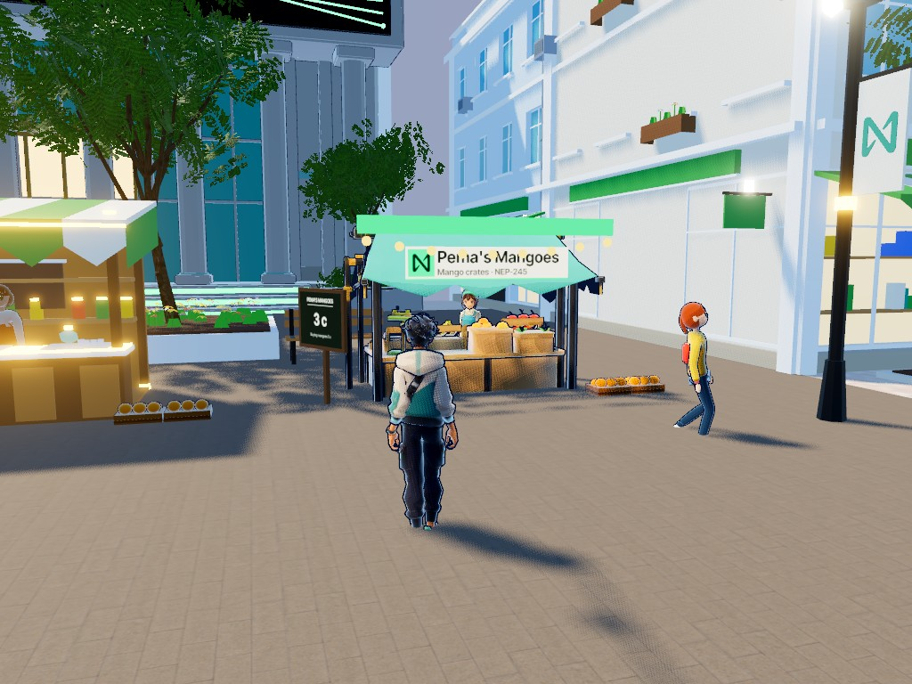
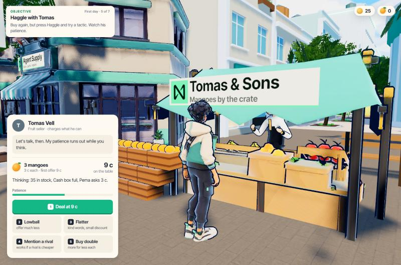
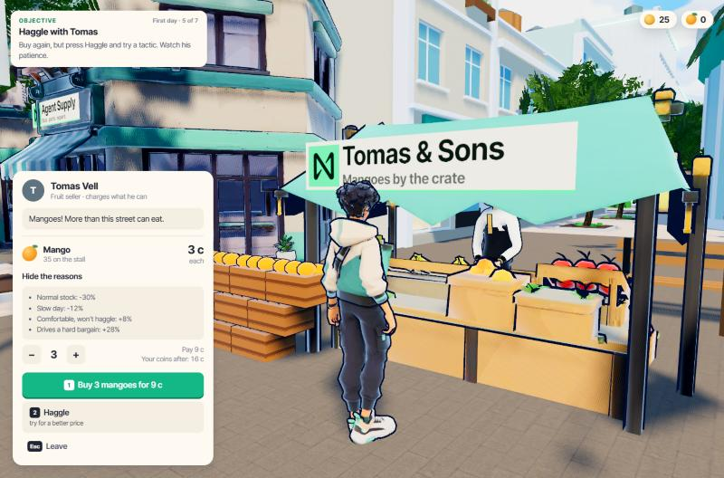
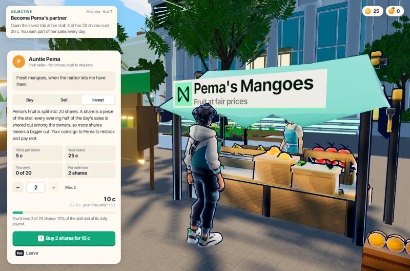
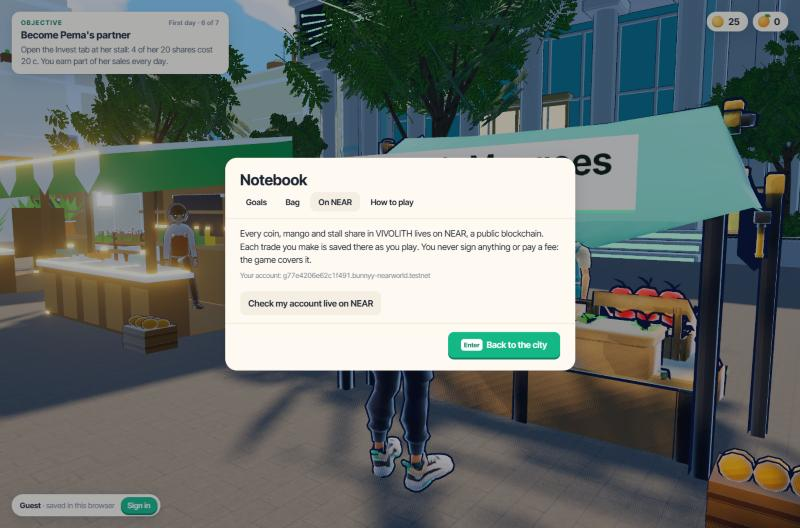
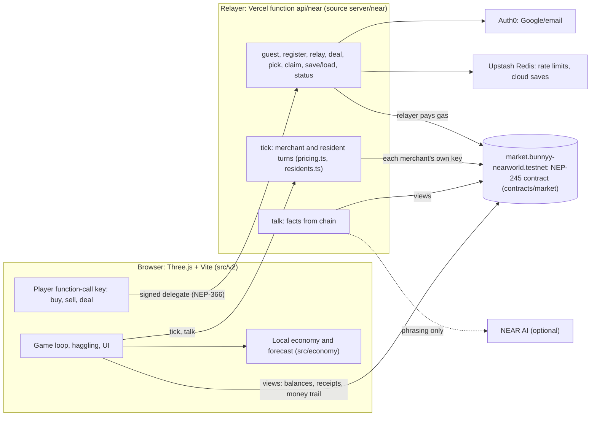

# VIVOLITH

A 3D anime-style market city in the browser. Stalls must make rent, merchants are agents with their own NEAR
accounts, prices move with real stock, and the player haggles, delivers and buys stall shares to decide whose lights
stay on at Rent Night. The economy is the gameplay; the chain stays out of sight (no wallet, no popup, no gas prompt).

Built for the NEAR Hackathon 2026, track **Games With Real Economies**.

- **Play:** https://vivolith.world (mirror: https://vivolith.vercel.app). Desktop browser, keyboard and mouse.
- **Market contract (NEAR testnet):** [`market.bunnyy-nearworld.testnet`](https://testnet.nearblocks.io/address/market.bunnyy-nearworld.testnet)
- **Merchants, each its own account:** `pema`, `tomas`, `mira`, `arin` `.bunnyy-nearworld.testnet`



## The game

Saltlight is a city under the NEAR Spire. A market day runs from 09:00 to 21:00 in five real minutes. At 21:00
(Rent Night) the clock stops, each merchant says where they stand from their real till and rent, and the evening
report opens. A stall that cannot pay its rent closes.

| Cadence | You do | What changes |
|---|---|---|
| 30 s | Haggle (pick tactics against a patience bar), read a chalkboard's price reasons, ask a merchant why | The deal is a price the merchant signed; stock and till move, so the next price moves |
| 5 min | Pick mangoes at the Orchard, buy where they are cheap, sell where they are missing, help a stall before Rent Night | A stall makes rent or closes; townsfolk and residents trade around the result |
| Session | Buy stall shares, collect dividends, climb the trader rank, fast-forward a week | Shares earn from every later sale; the Market Guild lends to stalls in trouble |

The four merchants differ by strategy, all in one readable pricing file, [`src/economy/pricing.ts`](src/economy/pricing.ts):
Pema is loyal and never gouges, Tomas charges what a shortage allows, Mira buys surplus and undercuts, Arin pays a
steady price for mangoes.

| | |
|---|---|
|  |  |
|  |  |

## Five-minute walkthrough

| # | Action | Expected result |
|---|---|---|
| 1 | Open https://vivolith.world, type a name, press **Enter** (or **Continue with Google**) | You arrive in the city with a 40-coin purse. A NEAR testnet account was made for you in the background; no wallet or popup |
| 2 | Follow the gold marker (also on the minimap; **M** opens the full map) to Pema, press **F** | Pema's fruit stall. Her chalkboard shows each price and its reason, plus a rent strip (till against rent) |
| 3 | At the Orchard sign between 06:00 and 11:00 game time, press **F** | 3 free mangoes in your bag (**B**), once per market day; the toast names the best current bid |
| 4 | Buy mangoes from Tomas | Coins leave your purse, mangoes enter your bag; the trade is a testnet transaction |
| 5 | Sell them to Pema | Her shelves fill and her price drops: you earned by moving goods to where they were missing |
| 6 | Trade again, press **Haggle**, pick tactics | The merchant's patience bar reacts; the final price is one the merchant signed, settled on chain |
| 7 | In a trade panel press *Why … c?*, then *Ask* | The merchant explains the price from facts read on chain (till, rent, stock, orders, receipts) |
| 8 | Open **Invest** at a stall and buy a pack of shares | You own part of the stall and earn from every sale from then on |
| 9 | Play on to 21:00 | Rent Night: each merchant reports their evening, closed stalls go dark, the evening report opens |
| 10 | Press **N** | Your NEAR account, balances, receipts with explorer links, and a money trail of who paid whom read from the contract |
| 11 | Press **T** (unlocked by the goals) | A week of the city in about a minute: rent nights, closures, restocks, what your shares would earn. Labelled as a forecast |

Controls: WASD move, Shift run, Q/E or arrow keys turn the camera, F talk or trade, B bag, J goals, M map, H help,
N NEAR account, T fast-forward, Esc menu. Adding `?offline` to the URL runs the local economy only and says so.

## What is real, what is simulated, what is unfinished

| Real on NEAR testnet | Simulated locally, and labelled so | Not done |
|---|---|---|
| One NEP-245 multi-token contract (`contracts/market`, Rust, near-sdk) holding coin, mango, lemon, lassi and `share:<stall>` | The week fast-forward (a forecast run on a copy of the city) | `NEAR_AI_KEY` is not set in production, so *Ask* answers are the scripted fallback (same facts; never labelled as AI) |
| Every player buy, sell, haggled deal, share purchase and buyback; Orchard picks minted as goods | Walking townsfolk, cars, day and night (the player's own clock) | The second resident, Dev (`porter`), has no account yet; only Lin (`picker`) trades on chain |
| Merchant asks and bids posted by each merchant's own key; rent every two market days, closures, reopening, dividends, Guild loans | Story flags and position (browser save; cloud save when signed in) | The 5-minute market-turn schedule is off (see below), so the city trades only while someone plays |
| A 40-coin starter purse, once per account | | Google/email sign-in has not been tested end to end with a real login |
| Resident Lin sells a day's picking into the best bid and buys a lassi, with buy/sell-only keys | | `www.vivolith.world` has a certificate mismatch; use the apex domain |
| | | No demo video yet |

- Players sign moves with a function-call key limited to `buy`, `sell` and `deal`; the relayer pays gas through
  NEP-366 meta-transactions. A display name is guest access only and never names an account or key.
- Signing in with Google moves a guest's coins, goods and shares into the Google account, keeping one starter purse.
- A market day on chain is 10 real minutes (from the wall clock). A market turn (`POST /api/near/tick`) reprices
  merchants, lets them trade with each other, records street shoppers, harbor freight and the tea kitchen, and runs
  residents. Players' browsers trigger turns. One turn runs at a time (atomic lock), and rent and settlement are once
  per market day in the contract, so late or repeated triggers never double anything.
- The model behind *Ask* decides nothing: it moves no coin and sets no price. A reply with any number not in the
  facts, an error or a 4 s timeout falls back to the scripted line ([`server/near/talk.ts`](server/near/talk.ts)).
- Economy rules and proofs: [docs/ECONOMY_MATH.md](docs/ECONOMY_MATH.md).

**Scheduled market turns.** [`.github/workflows/tick.yml`](.github/workflows/tick.yml) is manual only
(`workflow_dispatch`), so a push never starts automated transactions. To keep the city trading with nobody online,
the owner adds `schedule: - cron: "*/5 * * * *"` under `on:` (the file shows where).

## Verified on-chain evidence

Check it yourself with no keys: `node scripts/near/verify.mjs` reads the contract from public archival RPC and prints
its code hash, merchants, the contract's own `audit`, the live order book, NEP-245 supply, and the transactions below
with their NEP-245 events. On 2026-11-11 it reported audit OK and all eight transactions confirmed.

| Step of the player journey (`scripts/near/e2e.ts`) | Transaction |
|---|---|
| Guest account created (function-call key only) | [7FmsiLPF…](https://testnet.nearblocks.io/txns/7FmsiLPFyiu3EXodmvpFiujfwWC8oR8H45W3Z2eRe6PE) |
| Player registered, starter coins minted | [2Pvc9K9L…](https://testnet.nearblocks.io/txns/2Pvc9K9LFynbCcrfNGdjo1wRuQK1nroH4UszBrA3wtBx) |
| Buys 3 mangoes at Tomas's posted price (meta-transaction) | [CaA3WN7W…](https://testnet.nearblocks.io/txns/CaA3WN7WEWcj7jZNUjgrND4CvBgpE1HktTuxZenZXXyY) |
| Sells 3 mangoes to Pema at a price Pema signed (ed25519 checked on chain) | [7reZrbXQ…](https://testnet.nearblocks.io/txns/7reZrbXQiur9NqbSQrWgK2s1nZK8ALDp7jAmuktzgbBQ) |
| Invests in 30 Pema shares (reserve and till split) | [eyF1JCdx…](https://testnet.nearblocks.io/txns/eyF1JCdxanLkzSxX5EHpsiwmmfifySToLEz64K1mqyS) |
| Sells 15 shares back for exactly the backing | [HzKujJMX…](https://testnet.nearblocks.io/txns/HzKujJMXrtZuxEYuFXu2bwg2z37GqWCfvFZBmo4iw7w) |
| Dividends settled for all four stalls | [7g4zoX9s…](https://testnet.nearblocks.io/txns/7g4zoX9scGAeicNkdR9c6Q8zwE2TViQgQi7pXqbQWqGQ) |
| Owed dividend claimed (1 c paid, 0.35 c carried) | [J3qmH7oT…](https://testnet.nearblocks.io/txns/J3qmH7oTxvd3Ni35XvgJJpufcNjaK5Zki8LraEYmFZqc) |

Resident Lin ([`picker.bunnyy-nearworld.testnet`](https://testnet.nearblocks.io/address/picker.bunnyy-nearworld.testnet)),
from `scripts/near/resident-check.ts --run`: account created by the relayer with buy/sell-only keys
([8tHACjRJ…](https://testnet.nearblocks.io/txns/8tHACjRJ8zxrbG3siwFAVcGzmPbPzW4eQ3ct6P8egYoq)), sold mangoes
([GxvGBV8g…](https://testnet.nearblocks.io/txns/GxvGBV8gCw2dLb6mbWctD7NRsD2u7a4FEgsFBU75JwHE)) and bought a lassi
([24zVvkQk…](https://testnet.nearblocks.io/txns/24zVvkQkRnujw6jYwg1kXNVjn6YE2C3C5DV6Ld9RLWMU)). On 2026-11-11 the
contract's `get_receipts` for Lin listed 8 receipts: 5 mango sales and 3 lassi purchases.

Performance, measured on an RTX 3050 at 1920x1080 (2026-11-09): 108 to 119 fps average along the avenue and in the
market, no frame over 20 ms ([docs/PROGRESS.md](docs/PROGRESS.md)).

## Architecture



| Path | What it is |
|---|---|
| `index.html`, `src/v2/` | The game: toon renderer, controller, camera, market, audio, map, menus |
| `src/economy/` | Pricing rules, haggling, residents, the local economy and its checks |
| `src/near/` | Browser side of NEAR: keys, relayer calls, views |
| `server/near/` | Relayer handlers (served by the dev server plugin in `vite.config.ts`), bundled to `api/near/[route].js` by `npm run build:api` (generated, committed for Vercel) |
| `contracts/market/` | Rust NEP-245 market contract and its unit tests |
| `scripts/near/` | Deploy, verify, ledger, end-to-end and resident checks against testnet |
| `scripts/audio/` | One-off ElevenLabs generation of `public/audio` |
| `blender/` | Python build scripts for the city, NEAR Spire, landmarks, characters, Tripo props and cars |
| `public/` | Runtime assets: GLB models, audio, brand marks, HDRI, Draco decoder |
| `assets-src/` | Source brand files and generated textures that the Blender scripts read |
| `docs/` | Design, economy math, progress log; `docs/evidence/` holds the screenshots behind quality claims |

## Run it

Requirements: Node.js 24 or newer.

```bash
npm install
npm run dev
```

Open http://localhost:5173. With no `.env.local` the game runs fully local and says so. To connect to testnet, copy
`.env.example` to `.env.local` and fill it in (each variable is explained there).

## Checks

These need no keys:

```bash
npm run typecheck
node src/economy/economy.check.ts
node src/economy/haggle.check.ts
node src/physics/collision.check.ts
npm run build
node scripts/near/verify.mjs
```

Results on 2026-11-11: all passed; `verify.mjs` reported audit OK and 8 of 8 transactions confirmed.

With testnet keys in `.env.local`:

- `node scripts/near/resident-check.ts`: read-only dry run (views only, sends nothing). `--run` sends real transactions.
- `node scripts/near/e2e.ts`: the full player journey with real transactions.
- `node scripts/near/link-check.ts`: guest to Google/email account linking with real transactions.
- `cd contracts/market && cargo test`: contract unit tests (needs a Rust toolchain).

## AI development disclosure

VIVOLITH was made by one developer, Bunny, with substantial AI assistance. Bunny set the direction (the game design,
the NEAR Spire, the anime look, the economy rules), reviewed the output, and played and verified each change in the
browser and on testnet. Most of the code was written by AI coding agents working under that direction.

- **Code and docs:** mostly Claude Code (Anthropic). This covers the TypeScript game, the relayer, the Rust contract,
  the Blender Python scripts, the checks and the docs. The planning files in `docs/` were written as work orders for
  the agents.
- **3D models:** Kavi (the hero), Pema's model, the two cars, the fruit stall, the corner shop and other street props
  were generated with Tripo (text, image and multiview to 3D, auto-rig, preset animations). Scripts in `blender/`
  then rescale, re-shade, decimate and add collision (for example `blender/fix_cars.py` splits out the wheels so they
  spin and steer). The city, the NEAR Spire, the landmarks and the rest of the anime cast are generated by the
  Blender scripts in this repo.
- **Audio:** all 50 files in `public/audio` (merchant voices, effects, ambience, music) were generated with ElevenLabs
  (`eleven_v4`, `eleven_text_to_sound_v3`, `music_v2_5`) by `scripts/audio/generate.ts`.
- **Not AI-generated:** the Poly Haven assets below, the official NEAR brand marks, and the Three.js Draco
  decoder.

## Credits and licenses

- Code and the assets built by our Blender scripts: MIT ([LICENSE](LICENSE)). The MIT licence does **not** cover
  third-party or AI-generated assets (Tripo models, ElevenLabs audio, NEAR
  marks); they keep their own terms and are here only so the game runs. See
  [docs/ASSETS.md](docs/ASSETS.md#licence-scope) for the file-by-file list.
- [Poly Haven](https://polyhaven.com) models, textures and the HDRI (CC0), by the authors named in `docs/ASSETS.md`.
- 3D generation by [Tripo](https://www.tripo3d.ai); voices, effects and music by [ElevenLabs](https://elevenlabs.io).
- NEAR, NEAR AI and NEAR Intents marks belong to their owners and are used following the NEAR brand guidelines. The
  in-game buildings are fictional, not official NEAR offices.
- Built with [Three.js](https://threejs.org), [Vite](https://vite.dev), [near-api-js](https://github.com/near/near-api-js),
  [near-sdk-rs](https://github.com/near/near-sdk-rs), Auth0 and Upstash.
