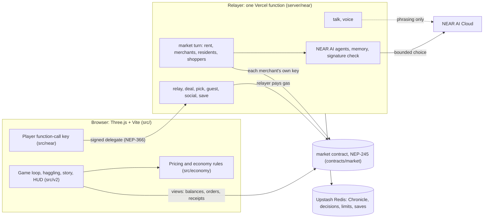

# VIVOLITH

**A market town where every merchant keeps a real till, and the stall you save stays saved.**


**[Play at vivolith.world](https://vivolith.world)** &nbsp;·&nbsp; **[Judge's ledger](https://vivolith.world/ledger)** &nbsp;·&nbsp;
[Five-minute path](#five-minutes-in-saltlight) &nbsp;·&nbsp; [Verify every claim](#verify-every-claim) &nbsp;·&nbsp; [Source map](#source-map)

VIVOLITH is a 3D trading game in Saltlight, a city under the NEAR Spire. Four merchants run fruit and lassi stalls,
each with their own till, stock and pricing strategy, and each must pay rent. You haggle, carry goods to where they are
missing and buy into stalls you believe in. When a merchant cannot pay rent the shutters come down, and only trade
opens them again.

Every merchant is a NEAR account, every trade you make is a NEAR testnet transaction, and NEAR AI moves prices one
coin at a time inside fixed bounds. You never see a wallet, a gas fee or a popup. Desktop browser, keyboard and mouse;
type a name and you are in.

## Five minutes in Saltlight

The shortest path through what makes VIVOLITH different. Open **[vivolith.world/ledger](https://vivolith.world/ledger)**
(the game, with the ledger switched on) and:

1. **Arrive.** Type a name, press Enter. You start with 40 coins, and a NEAR account was created for you in the
   background: no wallet, no seed phrase.
2. **Meet Pema.** Follow the gold marker and press **F**. Her story is told from her real till and rent: open,
   struggling or already shut.
3. **Ask her anything** in the box under her line, for example *"Why is your stall closed?"* NEAR AI phrases the answer
   from her on-chain facts; an answer with any number not in those facts is replaced.
4. **Buy 3 mangoes from Tomas, then sell one to a closed stall.** The shutters go up. That was two NEAR transactions,
   signed by your own key and relayed for you.
5. **Press N.** The ledger shows your NEAR account, every receipt with its explorer link, and a live read of your
   balances from the contract.

Then play on: **Haggle** in any trade (tactics against a patience bar), **Invest** in a stall (shares that pay
dividends from every later sale), and stay for **Rent Night at 21:00**, when every merchant reports their evening and a
stall that cannot pay closes.

Controls: **WASD** move · **Shift** run · mouse or **Q/E** look · **F** talk or trade · **B** bag · **J** goals ·
**M** map · **C** town news · **H** help · **Esc** menu.

## One decision, traced on chain

A stall that misses rent closes. One mango delivered to it reopens it, even when another stall pays as much for that
mango. Whether you help is up to you, and the chain keeps the result.

| The choice | The consequence |
|---|---|
|  |  |

Both screenshots show one new player on production on 2026-11-14. The same session on NEAR testnet:

| | What happened | Transaction |
|---|---|---|
| Arrive | A guest account is created for the player, holding only a key for trading | [`3tRuy2fW…`](https://testnet.nearblocks.io/txns/3tRuy2fWwy7jLANd8LMCDpXrELzpymCfB5P73WBghJaD) |
| Buy | The player buys 3 mangoes from Tomas at 4 c: purse 40 → 28 c | [`FS54fN88…`](https://testnet.nearblocks.io/txns/FS54fN889VDpyUSqDrTLUxo7dRSY9DiACa3BX9vqJ4Vh) |
| Rescue | Pema's till is empty, so the Market Guild advances her 5 c: enough to bid for the one mango she needs | [`G1ARMXdu…`](https://testnet.nearblocks.io/txns/G1ARMXdujweiFcCjmAbCgEU7Vr2SRievrfYPnxZnKLoP) |
| Deliver | The player sells Pema 1 mango for 5 c; the contract counts the delivery and reopens her stall | [`HEwAwEi8…`](https://testnet.nearblocks.io/txns/HEwAwEi8vsfGLkBeGkTTqa5FMrANBCk11AL1D3aXvLki) |
| Supply | Earlier that day Tomas's harbor contract landed 14 mangoes (he paid 28 c freight), reopening his own stall | [`2BjftdZe…`](https://testnet.nearblocks.io/txns/2BjftdZegMUXMwwh4wxFh7J8M3RE6dJXkJkw1LzzXRJF) |
| Reprice | On market turns NEAR AI moves merchants' prices; here it lowers Arin's mango bid from 6 to 5 c | [`CznTaWJh…`](https://testnet.nearblocks.io/txns/CznTaWJhctgxL7RSMYubwUMyU5vGJBJUb62uaZEXuFBa) |


## What NEAR and NEAR AI actually do

| On NEAR testnet | Decided by NEAR AI, within bounds | In the browser, and labelled so |
|---|---|---|
| One NEP-245 multi-token contract ([`contracts/market`](contracts/market/src/lib.rs), Rust): coin, mango, lemon, lassi and `share:<stall>` | Each merchant's price: raise, hold or lower by one coin inside a band, from chain state | Walking, traffic, day and night, the story's camera |
| Every player buy, sell, haggled deal, share purchase, buy-back and dividend claim | Resident Lin: where to sell her picking and where to eat, among real posted orders | The week fast-forward, labelled "forecast, not real trades" |
| Each merchant's asks and bids, posted from that merchant's own account | Conversation: phrasing only; every number is checked against the facts | Offline play when no relayer is configured |
| Rent, closures, reopenings, the Market Guild's loans and dues, dividends | | |

**No wallet, still the player's own key.** A guest is a sub-account holding only a function-call key for `buy`, `sell`
and `deal`. The browser signs a NEP-366 delegate action; the relayer ([`handlers.ts`](server/near/handlers.ts) `relay`)
submits it and pays gas after checking the receiver, the method, a zero deposit, bounded gas and that it created the
sender. A haggled price is valid only with the merchant's ed25519 signature, checked by the contract.

**NEAR AI decides, bounded.** Jev (`typesafe/jev-1.13`, [`agent.ts`](server/near/agent.ts)) receives one merchant's
chain state and picks one of a few named options, each an existing order or a one-coin move inside the band. Below
0.5 confidence, on any error, over budget or under the kill switch, the deterministic rule in
[`pricing.ts`](src/economy/pricing.ts) decides instead, and every decision is labelled `ai` or `rule`. NEAR AI's ed25519
signature over the exact request and response is checked ([`verify.ts`](server/near/verify.ts)); the TEE quote is not
validated, so the game never claims "verified". AI never moves coins, mints, signs a player's trade or sets a price
outside the band.

Accounts: merchants [`pema`](https://testnet.nearblocks.io/address/pema.bunnyy-nearworld.testnet) ·
[`tomas`](https://testnet.nearblocks.io/address/tomas.bunnyy-nearworld.testnet) ·
[`mira`](https://testnet.nearblocks.io/address/mira.bunnyy-nearworld.testnet) ·
[`arin`](https://testnet.nearblocks.io/address/arin.bunnyy-nearworld.testnet), resident Lin
[`picker`](https://testnet.nearblocks.io/address/picker.bunnyy-nearworld.testnet) and the contract
[`market`](https://testnet.nearblocks.io/address/market.bunnyy-nearworld.testnet), all `.bunnyy-nearworld.testnet`.
Coin is an in-game token with no monetary value.

## Verify every claim

| Claim | See it live | Check it |
|---|---|---|
| Your trades are real NEAR transactions, signed by your own key | [/ledger](https://vivolith.world/ledger), then **N**: receipts with explorer links | the transactions above · `npm run verify` |
| Anyone can audit any player, and cannot change anything while doing it | `/inspect/<account>`, e.g. the player above: [/inspect/gb1872bf…](https://vivolith.world/inspect/gb1872bf2841bc798.bunnyy-nearworld.testnet) | [`inspect.ts`](src/near/inspect.ts) refuses every write · `inspect.check.ts` |
| NEAR AI price decisions are bounded, signed and labelled | [`/api/near/decisions?merchant=arin`](https://vivolith.world/api/near/decisions?merchant=arin): model, confidence, signature receipt, reasons, transaction | [`agent.ts`](server/near/agent.ts), [`verify.ts`](server/near/verify.ts) · `agent.check.ts` |
| The contract's books balance: custody, reserves, Guild loans | `npm run verify` prints the contract's own audit from public RPC | [`contracts/market`](contracts/market/src/lib.rs) · 55 Rust tests in CI |
| Rent, closure, rescue and reopening follow fixed rules | Pema's stall, at Rent Night | [`recovery.ts`](src/economy/recovery.ts) · `turn.check.ts` · [economy math](docs/ECONOMY_MATH.md) |

```bash
npm install
npm run verify      # public archival RPC, no keys: code hash, the contract's audit, order book, the transactions above
npm test            # 17 checks: pricing, haggling, recovery, relayer turn, NEAR AI agents, voice, inspection
```

[docs/VERIFICATION.md](docs/VERIFICATION.md) maps each claim to its code, its check and its on-chain evidence, and lists
what is simulated or not built. CI ([`ci.yml`](.github/workflows/ci.yml)) runs the typecheck, the checks, the build and
`cargo test --features upgrade` on every push.

## Source map



| Path | What it is |
|---|---|
| [`src/v2/`](src/v2) | The game: entry `main.ts`, gameplay `play.ts`, market and merchants, camera, renderer, HUD, audio |
| [`src/economy/`](src/economy) | Pricing strategies, haggling, recovery rules, residents, the offline market model and its checks |
| [`src/near/`](src/near) | Browser side of NEAR: player key, relayer calls, chain views, read-only inspection |
| [`server/near/`](server/near) | The relayer (entry `vercel.ts`, router `handlers.ts`), agents, verification, Chronicle, voice |
| [`api/near/`](api/near) | Generated bundle of `server/near` for Vercel (`npm run build:api`); do not edit |
| [`contracts/market/`](contracts/market) | The Rust contract and its 55 unit tests |
| [`scripts/near/`](scripts/near) | Deploy, verify, end-to-end journey, agent operations against testnet |
| [`blender/`](blender) | Python builds of the city, the NEAR Spire, landmarks and character processing |
| [`docs/`](docs) | [Economy math](docs/ECONOMY_MATH.md), [recovery rules](docs/ECONOMY_RECOVERY.md), [state ownership](docs/STATE_MACHINES.md), [verification](docs/VERIFICATION.md), [assets](docs/ASSETS.md) |

[AGENTS.md](AGENTS.md) is a short guide for coding agents: entry points, invariants and how to check changes.

## Run it locally

Requires Node.js 24 or newer.

```bash
npm install
npm run dev         # http://localhost:5173
```

With no `.env.local` the game runs fully offline and says so. To connect it to NEAR testnet, copy
[`.env.example`](.env.example) to `.env.local` and fill it in; every variable is explained there.

| Command | What it does |
|---|---|
| `npm run typecheck` | TypeScript, strict |
| `npm test` | All 17 checks (`node --test`), no keys, network mocked |
| `npm run build` | Client build, approved voice lines, relayer bundle |
| `npm run verify` | Public on-chain verification, no keys |
| `cd contracts/market && cargo test --features upgrade` | Contract unit tests (Rust toolchain) |
| `node scripts/near/e2e.ts` | The full player journey with real testnet transactions (needs keys) |

## Security model

- Player keys can call only `buy`, `sell` and `deal`; operator methods (mint, rent, settlement, Guild) are
  `only_operator` in the contract.
- A haggled price needs the merchant's ed25519 signature, before its expiry and with a fresh nonce; the relayer acts on
  a deal only for a caller holding a key NEAR shows on that account.
- Secrets live in environment variables only and never reach client code. The status route reports configuration,
  never keys.
- Every paid call (NEAR AI, voice) has a daily budget and a kill switch; voice speaks only the game's own lines.
- Write routes refuse cross-site requests and are rate-limited per address and per account.

## Built at NEAR Hackathon 2026

Track: **Games With Real Economies**. Built by one developer, Bunny; the commit history starts on 2026-11-06 and covers
the whole build. Before publication the history was filtered once to remove character models derived from Adobe
Mixamo (an early prototype; Mixamo's terms do not allow redistributing them as files). Commit dates and messages are
unchanged.

**AI-assisted development.** Bunny set the direction (game design, economy rules, the NEAR Spire, the look), reviewed
the output, and played and verified each change in the browser and on testnet. Most of the code and documentation was
written by AI coding agents, mostly Claude Code, working under that direction. The 3D characters and props were
generated with Tripo and processed by the scripts in `blender/`; voices, effects and music were generated with
ElevenLabs by `scripts/audio/generate.ts`. The city and the NEAR Spire are built by this repository's Blender scripts.

## Credits and licenses

Code and the assets our Blender scripts build: [MIT](LICENSE). Third-party and AI-generated assets (Tripo models,
ElevenLabs audio, NEAR marks, Poly Haven CC0 models, textures and HDRI, the three.js Draco decoder) keep their own
terms; [docs/ASSETS.md](docs/ASSETS.md) lists them file by file. NEAR, NEAR AI and NEAR Intents marks belong to their
owners; the in-game buildings are fictional. Built with [Three.js](https://threejs.org), [Vite](https://vite.dev),
[near-api-js](https://github.com/near/near-api-js), [near-sdk-rs](https://github.com/near/near-sdk-rs), Auth0 and
Upstash.
