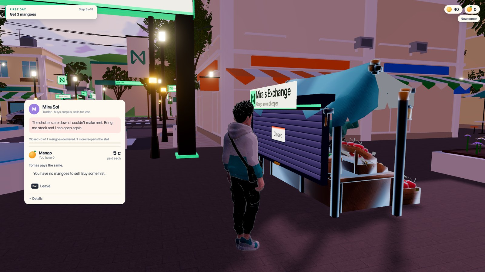
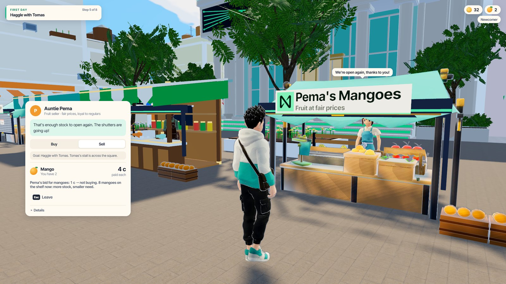
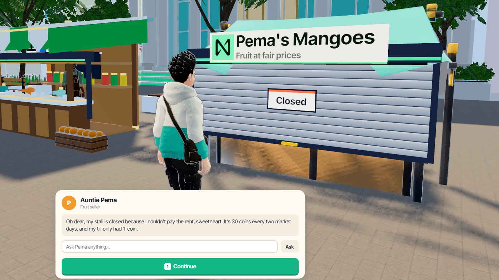
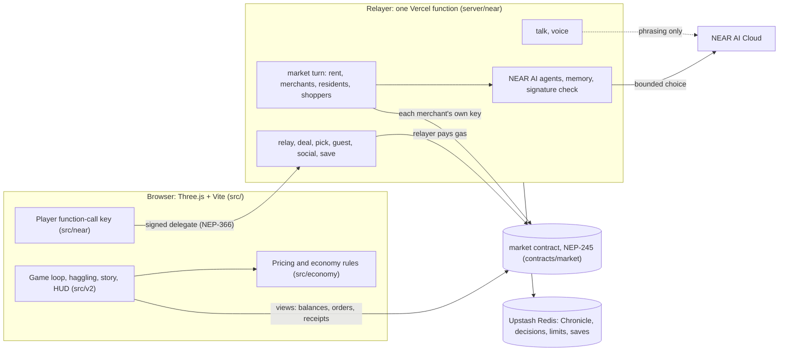

# VIVOLITH

**A market town where every merchant keeps a real till, and the stall you save stays saved.**


**[Play in your browser at vivolith.world](https://vivolith.world)**: desktop, keyboard and mouse. Type a name and
you are in. No wallet, no install, no popups.

VIVOLITH is a 3D trading game set in Saltlight, a city under the NEAR Spire. Four merchants run fruit and lassi stalls.
Each has their own till, their own stock and their own pricing strategy, and each must pay rent. You haggle, carry goods
to where they are missing and buy shares in stalls you believe in. When a merchant cannot make rent, the shutters come
down for real, and only trade can open them again.

NEAR makes the economy real. Each merchant is a NEAR account with its own till. Each trade you make is a testnet
transaction. NEAR AI moves some prices, one coin at a time, inside fixed bounds. You never see a wallet or a gas prompt.

## The core loop: one decision, traced end to end

A stall that misses rent shuts its shutters. One delivered mango reopens it, even when another stall pays the same or
more for that mango. That choice is the game.

| You choose to help her | The town changes |
|---|---|
|  |  |

Left: Mira's stall on production after the 2026-11-14 fixes. Right and below: Pema's reopening, step by step, on production on 2026-11-14 (NEAR testnet, checkable with `npm run verify`):

| Step | What happened | Transaction |
|---|---|---|
| Rent | A market turn charges every stall's rent; a stall that cannot pay closes (here Mira, 1 c short; Pema closed the same way) | [`GNcCYF74…`](https://testnet.nearblocks.io/txns/GNcCYF74wPsEEYTnMJayb5sp8aWuHsemQVbL2eV3WHnr) |
| Buy | A new player buys 3 mangoes from Tomas: purse 40 → 31 c | [`2eXEpbbC…`](https://testnet.nearblocks.io/txns/2eXEpbbCjnU3UeGXB29bEC8XsijDNphf6gBH76Zx9dog) |
| Deliver | The player sells Pema 1 mango for 1 c; her shutters roll up, and the town news records the reopening | [`7ywzZnoq…`](https://testnet.nearblocks.io/txns/7ywzZnoq1c5UxqYMZRQGpFXMX5zmXGh2A8hrKap6PS4F) |
| Reprice | On later turns merchants move their prices; here NEAR AI lowers Arin's mango bid from 6 to 5 c | [`CznTaWJh…`](https://testnet.nearblocks.io/txns/CznTaWJhctgxL7RSMYubwUMyU5vGJBJUb62uaZEXuFBa) |

## Try it: do this, see that

Your first decision comes within a minute of arriving.

| Do | See |
|---|---|
| Open [vivolith.world](https://vivolith.world), type a name, press **Enter** | You arrive with 40 coins; a NEAR testnet account was made for you in the background |
| Follow the gold marker to Pema and press **F** | Her story, told from her real till and rent: open, struggling or already closed |
| Type a question in her box, e.g. "Why is your stall closed?" | An answer phrased by NEAR AI from her on-chain facts |
| Buy 3 mangoes from Tomas, then sell to Pema | Coins and mangoes move on chain; her shelf, price and till change; a closed stall reopens |
| Press **Haggle** in a trade, or open **Invest** | Tactics against a patience bar; shares that pay dividends from every later sale |
| Play on to 21:00 (Rent Night) | Each merchant reports their evening; a stall that cannot pay closes |

**Judge tools:** [vivolith.world/?ledger](https://vivolith.world/?ledger) then **N** shows your NEAR account, receipts
with explorer links and decision evidence. `vivolith.world/?inspect=<account>` opens any player's wallet read-only.
**C** opens town news; **T** (unlocked by the goals) shows a week in a minute, labelled as a forecast.

Controls: **WASD** move, **Shift** run, mouse or **Q/E** look, **F** talk or trade, **B** bag, **J** goals, **M** map,
**H** help, **Esc** menu. `?offline` runs the same rules locally and says so.



## What runs where

| On NEAR testnet | Decided by NEAR AI, bounded | In the browser, and labelled so |
|---|---|---|
| One NEP-245 multi-token contract ([`contracts/market`](contracts/market/src/lib.rs), Rust, near-sdk 5.30): coin, mango, lemon, lassi and `share:<stall>` | Each merchant's price lever: raise, hold or lower by one coin inside a band, from chain state | Walking, cars, day and night, the story's camera |
| Every player buy, sell, haggled deal, share purchase, buy-back and dividend claim | Resident Lin: where to sell her picking and where to eat, among real posted orders | The week fast-forward ("forecast, not real trades") |
| Each merchant's asks and bids, posted by that merchant's own account | Free-form conversation: phrasing only, every number checked against the facts | Offline play when no relayer is configured |
| Rent, closures, reopenings, the Market Guild's loans and dues, dividends | | |

Merchants: [`pema`](https://testnet.nearblocks.io/address/pema.bunnyy-nearworld.testnet),
[`tomas`](https://testnet.nearblocks.io/address/tomas.bunnyy-nearworld.testnet),
[`mira`](https://testnet.nearblocks.io/address/mira.bunnyy-nearworld.testnet),
[`arin`](https://testnet.nearblocks.io/address/arin.bunnyy-nearworld.testnet) `.bunnyy-nearworld.testnet`;
resident Lin [`picker.bunnyy-nearworld.testnet`](https://testnet.nearblocks.io/address/picker.bunnyy-nearworld.testnet);
market contract [`market.bunnyy-nearworld.testnet`](https://testnet.nearblocks.io/address/market.bunnyy-nearworld.testnet).
Coin is an in-game token with no monetary value.

**How a player signs without a wallet.** A guest gets a sub-account of the relayer holding only a function-call key
for `buy`, `sell` and `deal` on the market contract. The browser signs a NEP-366 delegate action; the relayer
([`server/near/handlers.ts`](server/near/handlers.ts) `relay`) submits it and pays gas, after checking the receiver, the
method, a zero deposit, bounded gas and that the sender is an account it created. Google sign-in (Auth0) is available
to keep a market across devices.

## NEAR AI: what it controls and what it cannot

- **Decisions** ([`server/near/agent.ts`](server/near/agent.ts)). NEAR AI's decision model Jev (`typesafe/jev-1.13` on
  `cloud-api.near.ai/v1/systemone`) receives one merchant's chain state and chooses one of a few named options. Each
  option maps to an order that already exists or a one-coin move inside a band. Below 0.5 confidence, on a timeout,
  refusal, error, exhausted daily budget or the kill switch, the deterministic rule in
  [`src/economy/pricing.ts`](src/economy/pricing.ts) decides instead. Every decision is labelled `source: ai` or `rule`.
- **Signature check** ([`server/near/verify.ts`](server/near/verify.ts)). The exact request and response bytes are hashed;
  NEAR AI's ed25519 signature over them is checked, and the signer must appear in NEAR AI's attestation report. The TEE
  quote inside that report is not validated, so the game never claims "verified".
- **Conversation** ([`server/near/talk.ts`](server/near/talk.ts)). A chat model phrases the answer from chain facts.
  An answer containing any number not in the facts, or talking about chains or AI, is replaced by a scripted line.
- **What AI never does:** move coins, mint, sign a player's trade or set a price outside the stall's band.

## Verify it yourself

```bash
npm install
npm run verify      # reads the contract from public archival RPC: code hash, audit, order book, transactions above
npm test            # 17 checks: pricing, haggling, recovery, relayer turn handler, NEAR AI agents, voice, inspection
```

[docs/VERIFICATION.md](docs/VERIFICATION.md) maps every claim in this README to its code, its check and its on-chain
evidence, and lists what is simulated or not built.

## Architecture



| Path | What it is |
|---|---|
| [`src/v2/`](src/v2) | The game: entry `main.ts`, gameplay `play.ts`, market and merchants, camera, renderer, HUD, audio |
| [`src/economy/`](src/economy) | Pricing strategies, haggling, recovery rules, residents, the offline market model and its checks |
| [`src/near/`](src/near) | Browser side of NEAR: player key, relayer calls, chain views, read-only inspection |
| [`server/near/`](server/near) | The relayer (entry `vercel.ts`, router `handlers.ts`), agents, verification, Chronicle, voice |
| [`api/near/`](api/near) | Generated bundle of `server/near` for Vercel (`npm run build:api`); do not edit |
| [`contracts/market/`](contracts/market) | The Rust contract and its 55 unit tests |
| [`scripts/near/`](scripts/near) | Deploy, verify, end-to-end journey, agent operations against testnet |
| [`blender/`](blender) | Python builds of the city, the NEAR Spire, landmarks and character processing |
| [`docs/`](docs) | [Economy math](docs/ECONOMY_MATH.md), [recovery rules](docs/ECONOMY_RECOVERY.md), [state ownership](docs/STATE_MACHINES.md), [verification](docs/VERIFICATION.md), [assets](docs/ASSETS.md) |

[AGENTS.md](AGENTS.md) is a short guide for coding agents: entry points, invariants and how to check changes.

## Run it locally

Requires Node.js 24 or newer.

```bash
npm install
npm run dev         # http://localhost:5173
```

With no `.env.local` the game runs fully offline and says so. To connect it to NEAR testnet, copy
[`.env.example`](.env.example) to `.env.local` and fill it in; every variable is explained there. The production
deployment uses its own relayer account, NEAR AI key, Upstash Redis and ElevenLabs key, which a local run does not have.

| Command | What it does |
|---|---|
| `npm run typecheck` | TypeScript, strict |
| `npm test` | All 17 checks (`node --test`), no keys, network mocked |
| `npm run build` | Client build, approved voice lines, relayer bundle |
| `npm run verify` | Public on-chain verification, no keys |
| `cd contracts/market && cargo test --features upgrade` | Contract unit tests (Rust toolchain) |
| `node scripts/near/e2e.ts` | The full player journey with real testnet transactions (needs keys) |

CI ([`.github/workflows/ci.yml`](.github/workflows/ci.yml)) runs the typecheck, the checks, the build and the
contract tests on every push.

## Security model

- Player keys can call only `buy`, `sell` and `deal`. Operator methods (mint, rent, settlement, Guild) are
  `only_operator` in the contract.
- A haggled price is valid only with the merchant's ed25519 signature, before its expiry and with a fresh nonce.
- Secrets live in environment variables only and never reach client code (`vite.config.ts` hands them to the server
  plugin). The status route reports configuration, never keys.
- Every paid call (NEAR AI decisions, chats, signature checks, voice) has a daily budget, and there is a kill switch.
- Write routes refuse cross-site requests and are rate-limited per address and per account.

## Built at NEAR HACKATHON 2026

Track: **Games With Real Economies**. Built by one developer, Bunny; the commit history in this repository starts on
2026-11-06 and covers the whole build. Before publication the history was filtered once to remove character models
derived from Adobe Mixamo (an early prototype; Mixamo's terms do not allow redistributing them as files). Commit dates
and messages are unchanged.

**AI-assisted development.** Bunny set the direction (game design, economy rules, the NEAR Spire, the look), reviewed
the output, and played and verified each change in the browser and on testnet. Most of the code and documentation was
written by AI coding agents, mostly Claude Code, working under that direction. The 3D characters and props were
generated with Tripo and processed by the scripts in `blender/`; voices, effects and music were generated with
ElevenLabs by `scripts/audio/generate.ts`. The city and the NEAR Spire are built by this repository's Blender scripts.

## Credits and licenses

Code and the assets our Blender scripts build: [MIT](LICENSE). Third-party and AI-generated assets (Tripo models,
ElevenLabs audio, NEAR marks, Poly Haven CC0 models, textures and HDRI, the three.js Draco decoder) keep their own
terms; [docs/ASSETS.md](docs/ASSETS.md) lists them file by file. NEAR, NEAR AI and NEAR Intents marks belong to their
owners; the in-game buildings are fictional. Built with [Three.js](https://threejs.org), [Vite](https://vite.dev),
[near-api-js](https://github.com/near/near-api-js), [near-sdk-rs](https://github.com/near/near-sdk-rs), Auth0 and
Upstash.
